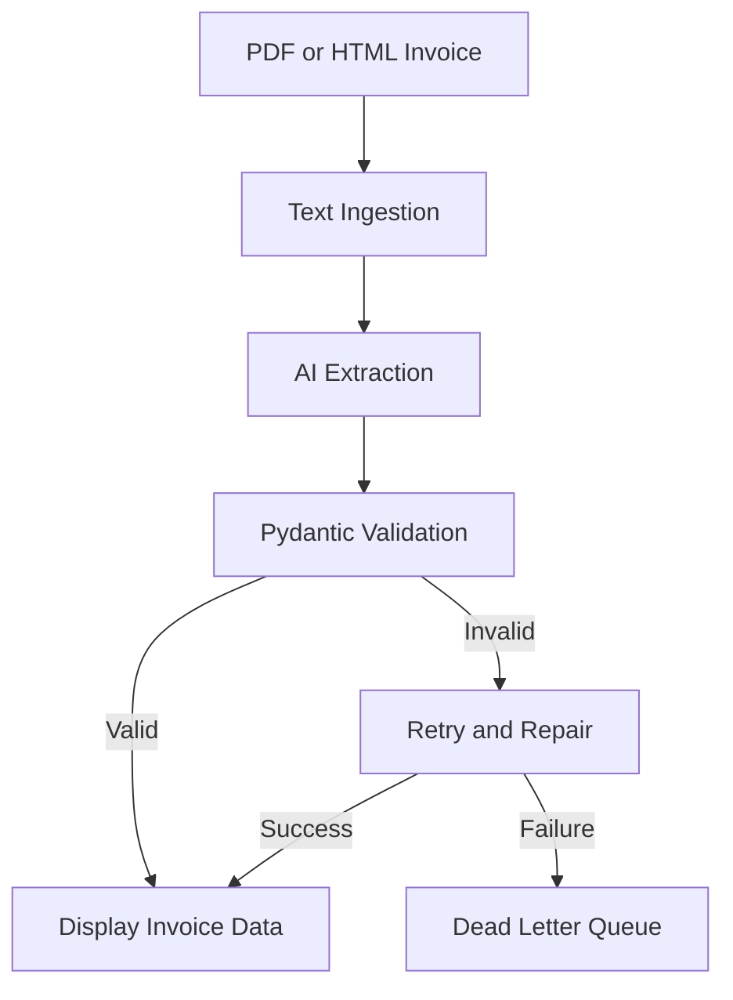

# Invoice Data Extractor

## Project Overview

This project extracts invoice information from PDF files and HTML text. It uses Python, Streamlit, OpenAI, and Pydantic v2 to extract and validate invoice data.

## Features

- Upload PDF invoices.
- Paste HTML invoice content.
- Extract readable text from invoices.
- Use AI to extract invoice fields.
- Validate data with Pydantic.
- Check invoice totals.
- Retry failed extractions.
- Repair JSON when possible.
- Save failed records to a dead-letter queue.
- Record errors for review.

## Technologies

- Python
- Streamlit
- Pydantic v2
- OpenAI API
- PyPDF
- BeautifulSoup
- JSON Repair
- Pytest

## Architecture



## Project Structure

## Project Structure

```text
structured-data-extractor/
├── src/
│   ├── app.py
│   ├── schemas.py
│   ├── extractor.py
│   ├── fallback.py
│   ├── ingestion.py
│   └── ai_extractor.py
├── tests/
│   ├── test_fallback.py
│   ├── test_ingestion.py
│   └── test_schemas.py
├── .gitignore
├── ai_prompt_log.md
└── README.md
```

The `.env` file stores the API key locally and must not be committed to GitHub.

## Setup

Create a virtual environment:

```powershell
py -m venv .venv
.\.venv\Scripts\Activate.ps1
```

Install the dependencies:

```powershell
python -m pip install streamlit "pydantic>=2" pypdf beautifulsoup4 json-repair openai anthropic pytest python-dotenv
```

Create a `.env` file in the project root:

```text
OPENAI_API_KEY=your_api_key_here
```

Keep the real API key private. Do not commit `.env` to GitHub.

## Run the Application

```powershell
python -m streamlit run .\src\app.py
```

## Run Tests

```powershell
python -m pytest tests -v
```

The project currently has 9 passing automated tests.

## Invoice Validation

The Pydantic schema checks required invoice fields, supported currencies, positive quantities, non-negative amounts, and whether invoice totals match line items and tax.

## AI Code Audit

See `ai_prompt_log.md` for actual coding issues, fixes, and lessons learned.

## Current Limitations

AI extraction requires a valid OpenAI API key and API access. Additional end-to-end tests with real invoice PDFs and HTML should be performed.
